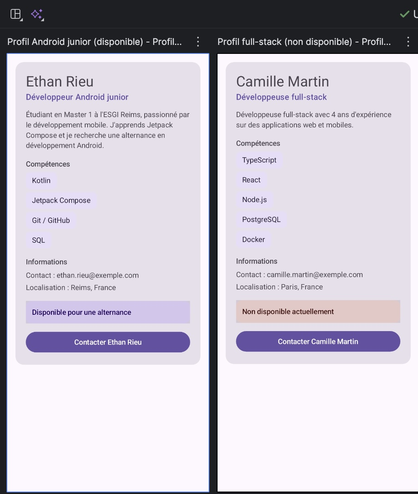
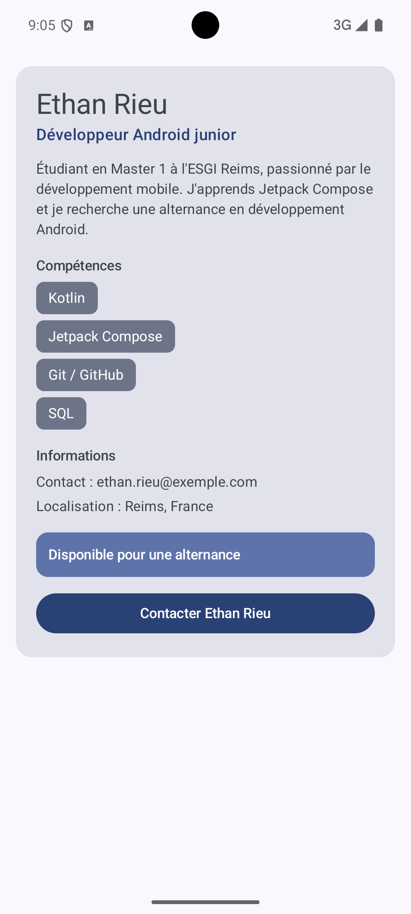

# Profil développeur Compose

Devoir ESGI M1 — Développement Android avec Jetpack Compose — Ethan Rieu (Reims)

## Description

Cette application affiche une fiche « Profil développeur » réalisée avec Jetpack Compose.
L'écran présente le nom, le rôle, une courte description, une liste de compétences,
des informations de contact et de localisation, ainsi qu'un badge de disponibilité cliquable
et un bouton « Contacter ». Les données du profil sont passées en paramètres, ce qui permet
d'afficher plusieurs profils différents avec les mêmes composables (voir les deux previews).

## Captures

**Previews** : deux variantes du profil (Android junior disponible / full-stack non disponible)



**Application lancée sur l'émulateur** (Pixel 8)



> Les couleurs diffèrent entre les previews et l'émulateur : le thème généré utilise les
> couleurs dynamiques (Android 12+), calculées à partir du fond d'écran de l'appareil.
> Les previews désactivent cette option (`dynamicColor = false`) pour garder un rendu stable.

## Notions utilisées

- fonctions composables (`@Composable`) ;
- paramètres et données passées aux composables (`DeveloperProfile`) ;
- `Modifier` passé en paramètre (`modifier: Modifier = Modifier`) ;
- chaînage de modifiers (`fillMaxWidth().clickable().semantics { }`) ;
- padding externe / padding interne ;
- callbacks (`onClick`, `onContactClick`, `onAvailabilityClick`) ;
- `Scaffold` et `innerPadding` ;
- composants `Text`, `Button`, `Surface`, `Column` ;
- thème généré du projet (`MaterialTheme`) ;
- previews (`@Preview`) ;
- accessibilité de base (`semantics`, `Role.Button`, `contentDescription`).

## Structure du code

```
app/src/main/java/com/example/profildeveloppeur/
├── MainActivity.kt                 # setContent + ProfileScreen avec les callbacks
├── model/DeveloperProfile.kt       # data class + deux profils d'exemple
└── ui/profile/
    ├── ProfileScreen.kt            # ProfileScreen, ProfileCard + les 2 previews
    └── ProfileComponents.kt        # petits composables réutilisables
```

## Explication courte

**1. Quels composables avez-vous créés ?**
`ProfileScreen`, `ProfileCard`, `ProfileHeader`, `SectionTitle`, `SkillItem`, `InfoLine`,
`AvailabilityBadge` et `ContactButton`, ainsi que deux previews :
`ProfileScreenAndroidJuniorPreview` et `ProfileScreenFullstackPreview`.

**2. Quel composable représente l'écran principal ?**
`ProfileScreen`. Il contient le `Scaffold` et place la fiche (`ProfileCard`) dans l'écran.
Il est appelé dans `MainActivity` via `setContent`.

**3. Où utilisez-vous un padding externe ?**
Dans `ProfileScreen`, le parent place la carte avec
`Modifier.padding(innerPadding).padding(16.dp)` : la carte est décalée des bords de l'écran
et des barres système. Dans `ProfileCard`, les éléments sont aussi espacés par le parent avec
`Modifier.padding(top = ...)` passé à `SkillItem`, `InfoLine`, `AvailabilityBadge`, etc.
C'est le parent qui décide de la position du composant.

**4. Où utilisez-vous un padding interne ?**
Dans `ProfileCard` (`Column(Modifier.padding(20.dp))` à l'intérieur de la `Surface`),
dans `SkillItem` (padding autour du texte de la pastille) et dans `AvailabilityBadge`
(`padding(12.dp)` autour du texte). C'est le composant lui-même qui espace son contenu
par rapport à ses propres bords.

**5. Quel composant reçoit un callback ?**
`ContactButton` reçoit `onClick` et `AvailabilityBadge` reçoit `onClick`.
Ils remontent par `ProfileCard` et `ProfileScreen` (`onContactClick`, `onAvailabilityClick`)
jusqu'à `MainActivity`, qui fournit pour l'instant des lambdas vides commentées.
Les composants signalent l'événement mais ne décident pas de la logique.

**6. Quelle information d'accessibilité avez-vous ajoutée ?**
`AvailabilityBadge` est une zone cliquable personnalisée (`Surface` + `clickable`).
J'y ai ajouté `semantics { role = Role.Button; contentDescription = "..." }` : un lecteur d'écran
annonce donc un bouton et lit une description claire de l'action
(ex. « Disponible pour une alternance. Appuyer pour en savoir plus. »).
Pour `ContactButton`, j'utilise `Button` : ce composant expose déjà le rôle de bouton
et son texte aux outils d'accessibilité, il est donc plus explicite qu'une simple zone cliquable.

**7. Pourquoi vos composants peuvent-ils être considérés comme réutilisables ?**
Ils n'affichent aucune donnée en dur : tout est reçu en paramètres (nom, rôle, compétence,
libellé, texte du bouton, callback…). Chacun accepte un `modifier: Modifier = Modifier`
appliqué à son élément racine, ce qui laisse le parent décider de son placement.
La preuve : les deux previews affichent deux profils différents avec exactement les mêmes composables,
et `SkillItem` / `InfoLine` sont réutilisés plusieurs fois dans la fiche.

## Lancer le projet

1. Ouvrir le dossier dans Android Studio.
2. Attendre la synchronisation Gradle.
3. Lancer la configuration `app` sur un émulateur, ou ouvrir `ProfileScreen.kt` en mode *Split* pour voir les previews.
